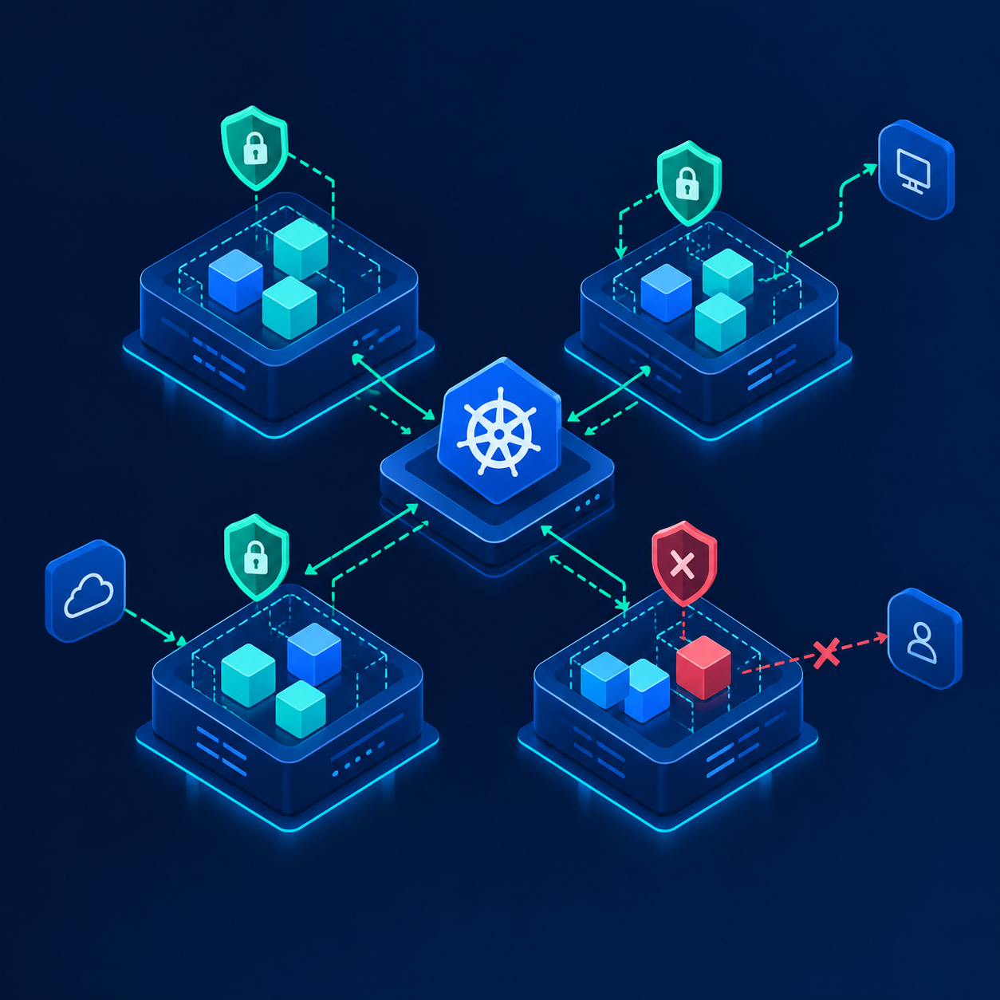

# Kubernetes Network Policies: A Practical Troubleshooting Guide

Kubernetes NetworkPolicies help control communication between workloads. However, a policy that looks correct on paper can still result in unexpected connectivity failures when labels, selectors, ports, or CNI configuration do not match.

In this guide, we will work through a practical troubleshooting workflow for pod-to-pod communication, examine common policy mistakes, and explore how Cilium can help diagnose network issues.



## 1. Understand the traffic flow

Start by identifying the source pod, destination pod, destination port, and namespace. Determine whether the traffic is governed by ingress or egress rules.

## 2. Inspect the policy

```bash
kubectl get networkpolicy -A
kubectl describe networkpolicy -n default
kubectl get pods -n default --show-labels
```

Check the selectors, namespace selectors, and allowed ports against the actual workloads.

## 3. Test connectivity

```bash
kubectl exec -it <source-pod> -- \
  curl -v --connect-timeout 5 http://<destination-service>:<port>
```

Compare the result before and after applying a policy. In a Cilium cluster, use Hubble flow visibility and Cilium endpoint information to investigate dropped traffic.

## 4. Troubleshooting checklist

- Verify pod labels and namespace selectors.
- Confirm the destination port and protocol.
- Check whether both ingress and egress policies apply.
- Review CNI health and network-policy enforcement.
- Use flow logs to distinguish a policy drop from routing or application failures.

## Conclusion

Troubleshoot Kubernetes networking layer by layer. Validate the policy, verify the endpoints, test the path, and use CNI-specific observability to identify where traffic is being dropped.
