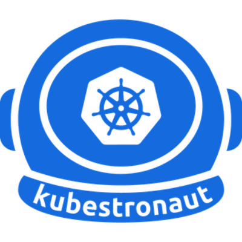

---
hide:
  - navigation
  - toc
---

# Engineering Reliable **Platforms at Scale.**

Hands-on KubernetesSREPlatform EngineeringCloud SecurityPython &amp; GoKubernetes

Platform architecture, Kubernetes, cloud-native infrastructure, networking, security, and SRE practices for building scalable, resilient production systems.
{ .hero-sub }

[Learn with me](services.md){ .md-button .md-button--primary }
[Troubleshooting guides](troubleshooting/overview.md){ .md-button }

  
<i></i><i></i><i></i>sre@prod-cluster

  

$ kubectl get pods -n shop

NAME           READY   STATUS             RESTARTS
api-7d9f-x2k   0/1     CrashLoopBackOff   6

$ kubectl logs api-7d9f-x2k --previous

Error: missing required env DATABASE_URL

$ kubectl rollout status deploy/api

deployment "api" successfully rolled out

$ <b></b>

  

<strong>5</strong>CNCF Kubernetes certifications

<strong>3</strong>hands-on exams: CKA · CKAD · CKS

<strong>9</strong>topic areas and growing

{ .credstrip-badge }

**CNCF Kubestronaut** 
All five Kubernetes certifications: CKA · CKAD · CKS · KCNA · KCSA

[See the credential](kubestronaut.md){ .md-button }

## Start here

- :material-restart-alert: **Debug a CrashLoopBackOff**

    A repeatable method for pods that keep restarting.

    [:octicons-arrow-right-24: Read](troubleshooting/pods.md#crashloopbackoff)

- :material-lan: **How Services and DNS really work**

    From Pod IPs to Gateway API.

    [:octicons-arrow-right-24: Read](networking/overview.md)

- :material-shield-lock: **Harden a cluster**

    A practical production baseline.

    [:octicons-arrow-right-24: Read](security/hardening.md)

## Fix it fast

[CrashLoopBackOff](troubleshooting/pods.md#crashloopbackoff){ .chip }
[ImagePullBackOff](troubleshooting/pods.md#imagepullbackoff){ .chip }
[Pending](troubleshooting/pods.md#pending){ .chip }
[OOMKilled](troubleshooting/pods.md#oomkilled){ .chip }
[Node NotReady](troubleshooting/nodes.md#notready){ .chip }
[DNS failures](troubleshooting/networking.md#dns-lookups-fail){ .chip }
[No endpoints](troubleshooting/networking.md#service-has-no-endpoints){ .chip }
[PVC Pending](troubleshooting/storage.md#pvc-stuck-in-pending){ .chip }

## Explore topics

- :material-kubernetes: **Kubernetes**

    Architecture, workloads, configuration and storage.

    [:octicons-arrow-right-24: Explore](k8s/01-overview.md)

- :material-lan: **K8s Networking**

    CNI, Services, DNS, Gateway API and policies.

    [:octicons-arrow-right-24: Explore](networking/overview.md)

- :material-wrench: **Troubleshooting**

    Step-by-step playbooks for pods, nodes, DNS and storage.

    [:octicons-arrow-right-24: Explore](troubleshooting/overview.md)

- :material-chart-line: **SRE**

    SLOs, monitoring, alerting and disaster recovery.

    [:octicons-arrow-right-24: Explore](sre/monitoring.md)

- :material-layers-triple: **Platform Engineering**

    Internal platforms, golden paths and GitOps.

    [:octicons-arrow-right-24: Explore](platform/overview.md)

- :material-shield-lock: **Security**

    Cluster hardening and software supply chain.

    [:octicons-arrow-right-24: Explore](security/overview.md)

- :material-code-braces: **Python & Go**

    Automation and tooling for reliable operations.

    [:octicons-arrow-right-24: Explore](programming/overview.md)

- :material-linux: **Linux**

    The foundations: automation and hardening.

    [:octicons-arrow-right-24: Explore](system/overview.md)

- :material-map-marker-path: **Cert Roadmaps**

    CNCF, AWS, Google Cloud, Azure and security paths.

    [:octicons-arrow-right-24: Explore](roadmaps/overview.md)

## Need a second pair of eyes on your cluster?

Kubernetes audits, SLO and alerting setup, and disaster recovery planning.

[Learn with me](services.md){ .md-button .md-button--primary }
[Read the blog](blog/index.md){ .md-button }

