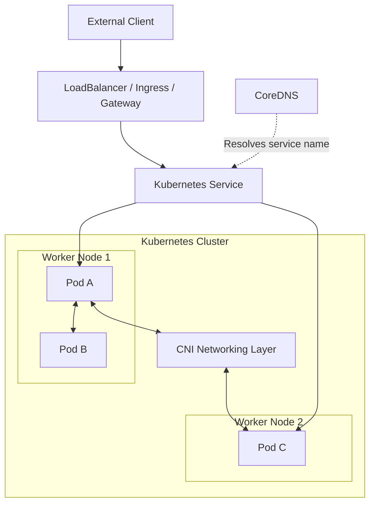

# Kubernetes Networking Deep Dive

Kubernetes networking enables Pods, Services, nodes, and external clients to communicate across a cluster. Understanding how traffic moves through these components is essential for Kubernetes administrators, platform engineers, and Site Reliability Engineers.

This guide explains the Kubernetes networking model from fundamentals to packet flow, service discovery, network security, and troubleshooting.

## What you will learn

- How Pod IP addressing and the Kubernetes networking model work
- How traffic travels between Pods on the same node and across nodes
- How Services, EndpointSlices, and CoreDNS enable service discovery
- How CNI plugins implement connectivity and network policy enforcement
- How external traffic reaches workloads through LoadBalancer, Ingress, and Gateway API
- How to troubleshoot common Kubernetes networking failures

## 1. Kubernetes Networking Architecture

A Kubernetes networking environment has several interconnected components:

- **Pods:** Workloads receive their own IP addresses.
- **Nodes:** Hosts that run Pods and provide the underlying network connectivity.
- **CNI plugin:** Configures Pod networking and may provide routing, overlays, and network policy enforcement.
- **Services:** Provide stable virtual addresses and select backend Pods.
- **CoreDNS:** Resolves Kubernetes service names.
- **NetworkPolicies:** Define permitted Pod communication when supported and enforced by the network plugin.

### High-level architecture

The diagram below illustrates the main relationships between clients, Services, Pods, and the networking layer.

